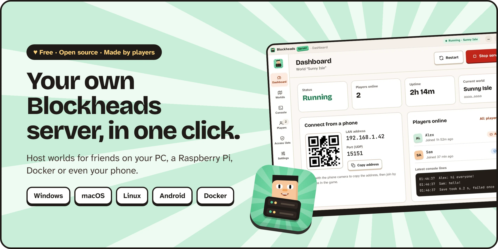
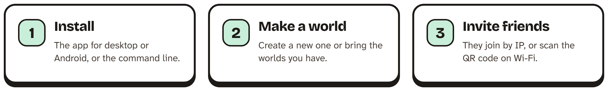
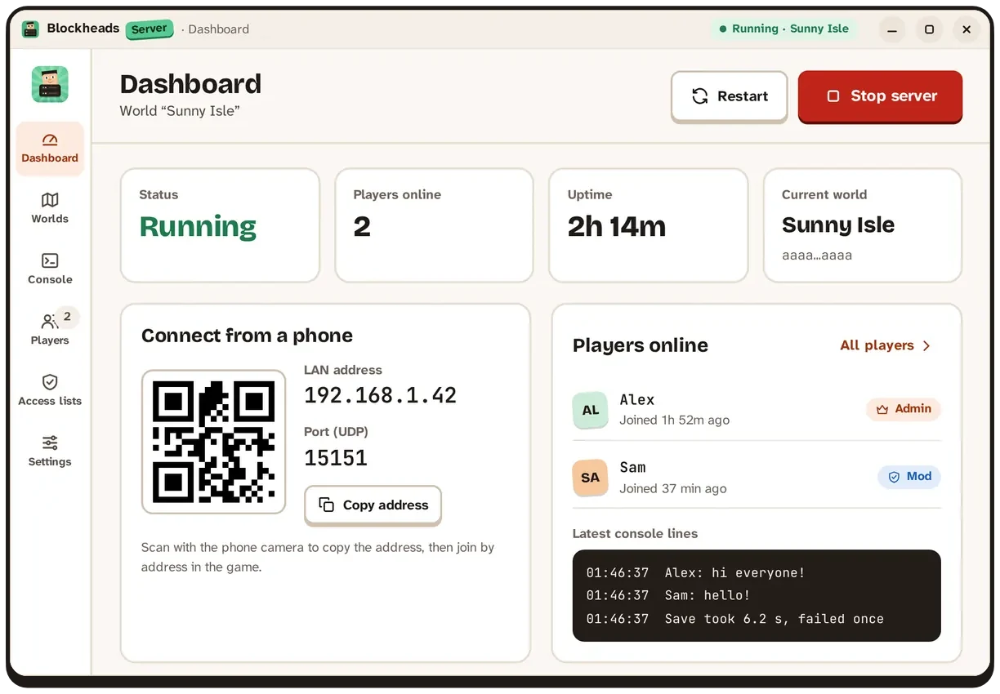
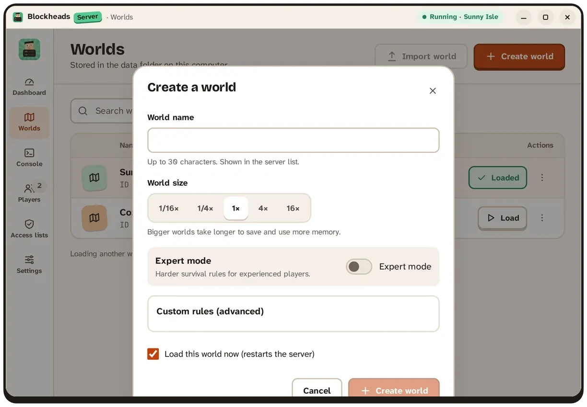
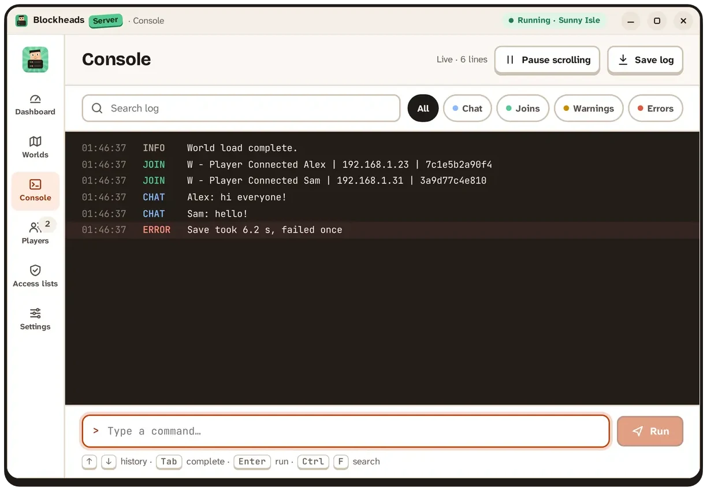
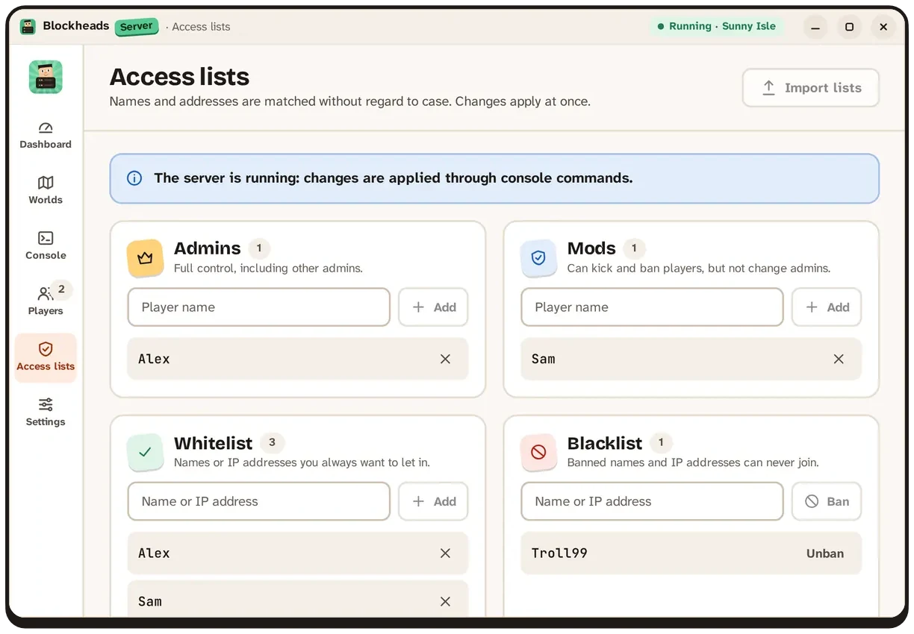
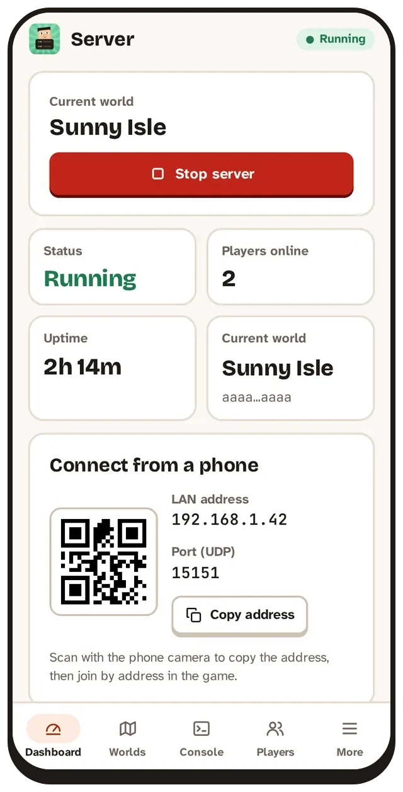
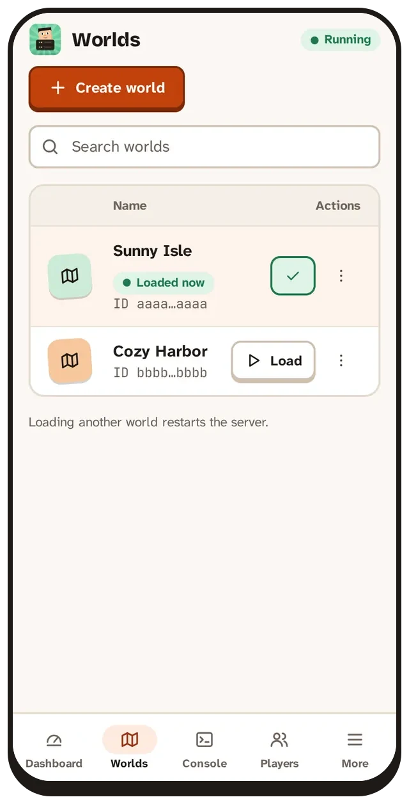

<p align="center">
  <a href="https://github.com/Blockheads-Club/blockheads-server/releases/latest">
    
  </a>
</p>

<p align="center">
  <a href="https://github.com/Blockheads-Club/blockheads-server/releases/latest"></a>
  <a href="https://github.com/Blockheads-Club/blockheads-server/releases"></a>
  <a href="https://github.com/Blockheads-Club/blockheads-server/stargazers"></a>
  <a href="LICENSE"></a>
</p>

<h3 align="center">
  <a href="https://github.com/Blockheads-Club/blockheads-server/releases/latest">⬇️ Download</a>
  &nbsp;·&nbsp;
  <a href="https://blockheads.club/docs/server">📖 Guide</a>
  &nbsp;·&nbsp;
  <a href="https://blockheads.club/docs/faq">❓ FAQ</a>
  &nbsp;·&nbsp;
  <a href="https://github.com/Blockheads-Club/blockheads-server/issues/new">🐞 Report a bug</a>
</h3>

<br>

Play The Blockheads with your friends on **your own server**. Start it from a friendly app on your computer or your
Android phone, or run it on a Raspberry Pi, a Linux box or Docker. Your existing worlds and every game client work
as they are.

> [!NOTE]
> **Alpha (v0.5.1 pre-release).** A from-scratch rewrite of the official Blockheads 1.7.1 server: same network
> protocol, same save files, same commands. Please [report what you find](https://github.com/Blockheads-Club/blockheads-server/issues).

## ✨ What you get

<table>
  <tr>
    <td width="50%" valign="top">
      <h3>🖱️ One-click hosting</h3>
      Pick a world and press Start. See who is online, read the live console and stop the server with one button.
    </td>
    <td width="50%" valign="top">
      <h3>📱 Runs on your phone too</h3>
      The same app runs on Android. Friends on the same Wi-Fi scan a QR code to get the address.
    </td>
  </tr>
  <tr>
    <td valign="top">
      <h3>🌍 Your worlds, unchanged</h3>
      Same save files as the original server. Create new worlds (size, expert mode, custom rules) or bring yours.
    </td>
    <td valign="top">
      <h3>🛡️ You are the admin</h3>
      Admins, mods, bans and whitelists from the app or with the familiar chat commands.
    </td>
  </tr>
  <tr>
    <td valign="top">
      <h3>🧩 Mods and voice chat</h3>
      Add mods in Lua, WASM or Java: commands, minigames, economy, land claims, even voice chat.
      Players without mods can still join servers that only use server mods.
    </td>
    <td valign="top">
      <h3>🐧 Anywhere you like</h3>
      Windows, macOS, Linux (x86_64, arm64 and armv7 / Raspberry Pi), Android and Docker.
    </td>
  </tr>
</table>

## 🚀 Host a world in 3 steps

<p align="center"></p>

<p align="center">
  <a href="https://github.com/Blockheads-Club/blockheads-server/releases/latest"></a>
  <a href="https://github.com/Blockheads-Club/blockheads-server/releases/latest"></a>
  <a href="https://github.com/Blockheads-Club/blockheads-server/releases/latest"></a>
  <a href="https://github.com/Blockheads-Club/blockheads-server/releases/latest"></a>
</p>

From the [latest release](https://github.com/Blockheads-Club/blockheads-server/releases/latest):

| How you want to run it | File |
| --- | --- |
| 🖱️ **App** (easiest) | Windows `.exe`, macOS `.dmg`, Linux `.AppImage` / `.deb` / `.rpm`, Android `.apk` |
| ⌨️ **Command line** | the `.tar.gz` / `.zip` for your system (Linux x86_64, arm64, armv7 / Raspberry Pi, Windows, macOS) |
| 🐳 **Docker** | `ghcr.io/blockheads-club/blockheads-server` |

<details>
<summary><b>Command line and Docker</b></summary>
<br>

```bash
./blockheads_server --new MYWORLD --port 15151
./blockheads_server --help      # same options as the original server
```

```bash
docker run -i --rm -p 15151:15151/udp -v bh-data:/data ghcr.io/blockheads-club/blockheads-server:0.5.1 --new MYWORLD
```

Guides: [Docker](https://blockheads.club/docs/guides/docker), [Raspberry Pi](https://blockheads.club/docs/guides/raspberry-pi),
[host on Android](https://blockheads.club/docs/guides/host-android).
</details>

**Friends join** in the game with **Join World → Advanced… → Online IP/Port**. On Android 10 and newer, the game
needs the popup fix from [Blockheads Patcher](https://github.com/Blockheads-Club/blockheads-patcher) before it can
connect. Playing over the internet: [open your server](https://blockheads.club/docs/guides/open-internet).

## 📸 Screenshots

<table>
  <tr>
    <td width="50%"></td>
    <td width="50%"></td>
  </tr>
  <tr>
    <td></td>
    <td></td>
  </tr>
</table>

<p align="center">
  
  &nbsp;&nbsp;
  
</p>

## 🧩 Mods

Put `.bhmod` files in the server's `mods/` folder, allow what they ask for in `mods.toml`, and restart:

```toml
[hello-lua]
grant = ["players:chat"]
```

Players with the PC client or the Android mod loader get the client part of a mod straight from your server.
Find mods at [blockheads.club/mods](https://blockheads.club/mods), make your own with the
[mod SDK](https://github.com/Blockheads-Club/mod-sdk). Everything about events, permissions, voice chat and Java mods:
[docs/mods.md](docs/mods.md).

## ❓ Questions

<details>
<summary><b>Do players need anything special?</b></summary>
<br>
Only their own copy of The Blockheads. Phones on Android 10 and newer need the popup fix from
<a href="https://github.com/Blockheads-Club/blockheads-patcher">Blockheads Patcher</a>.
</details>

<details>
<summary><b>Can I use my worlds from the original server?</b></summary>
<br>
Yes. The save files are the same, so you can copy them over and back.
</details>

<details>
<summary><b>My friend can't connect.</b></summary>
<br>
Check that they use the right IP and port (UDP, 15151 by default), that your firewall allows it, and for the internet
that the port is forwarded on your router. Step by step:
<a href="https://blockheads.club/docs/guides/lan-play">LAN play</a> and
<a href="https://blockheads.club/docs/guides/open-internet">open to the internet</a>.
</details>

<details>
<summary><b>Is this official?</b></summary>
<br>
No. It is an independent, free reimplementation for interoperability, not affiliated with Majic Jungle or Noodlecake.
</details>

## 🧱 Part of Blockheads Club

<table>
  <tr>
    <td align="center" width="25%"><a href="https://github.com/Blockheads-Club/blockheads-pc"><br><b>Blockheads PC</b></a><br><sub>Play on your computer</sub></td>
    <td align="center" width="25%"><a href="https://github.com/Blockheads-Club/blockheads-patcher"><br><b>Patcher</b></a><br><sub>Fix the game on your phone</sub></td>
    <td align="center" width="25%"><a href="https://github.com/Blockheads-Club/world-tool"><br><b>World Tool</b></a><br><sub>Move and edit your worlds</sub></td>
    <td align="center" width="25%"><a href="https://github.com/Blockheads-Club/mod-sdk"><br><b>Mod SDK</b></a><br><sub>Make your own mods</sub></td>
  </tr>
</table>

<p align="center">All apps, guides and downloads: <a href="https://blockheads.club"><b>blockheads.club</b></a></p>

## 🛠️ For developers

<details>
<summary><b>Build from source</b></summary>
<br>

You need Rust stable ([rustup](https://rustup.rs)). For the app also [bun](https://bun.sh); for Android the Android
SDK, NDK 27 and JDK 17 to 21.

```bash
git clone https://github.com/Blockheads-Club/blockheads-server.git
cd blockheads-server
cargo build --release -p blockheads_server
cargo test --workspace
```

The mod host (feature `mods`, on by default) uses `bhmod-core`, `bhmod-wasm`, `bhmod-manifest` and `bhmod-proto` from
[mod-sdk](https://github.com/Blockheads-Club/mod-sdk) as git dependencies pinned to one commit (to work on both
repositories at once, see [docs/development.md](docs/development.md#developing-against-a-local-mod-sdk)). Build
without it: `cargo build -p blockheads_server --no-default-features --features trace-rng`.

More: [docs/development.md](docs/development.md) (tests, data directory, embedding, the desktop and Android app,
releases) and [docs/mods.md](docs/mods.md) (the mod host).
</details>

Everyone can open [issues](https://github.com/Blockheads-Club/blockheads-server/issues) and pull requests. Irrelevant
or abusive issues may be closed or removed. Commits follow [Conventional Commits](https://www.conventionalcommits.org).

## 📄 License

Blockheads Server is free software under the **GNU GPLv3 or later** (GPL-3.0-or-later): you can redistribute it
and/or modify it under the terms of the GNU General Public License as published by the Free Software Foundation,
either version 3 of the License, or (at your option) any later version. See [LICENSE](LICENSE).
Third-party code ports are listed in [THIRD_PARTY_NOTICES.md](THIRD_PARTY_NOTICES.md).

Unofficial, independent reimplementation for interoperability. It contains no original binaries or assets and is not
affiliated with Majic Jungle or Noodlecake Studios. Players join with their own copy of The Blockheads.
