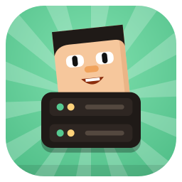

<p align="center">
  
</p>

<h1 align="center">Blockheads Server</h1>

<p align="center">
  Host your own <b>Blockheads</b> server for friends — on your PC, a Linux box, Docker or even your phone. 🌍
</p>

<p align="center">
  
  <a href="https://github.com/Blockheads-Club/blockheads-server/releases"></a>
  <a href="https://github.com/Blockheads-Club/blockheads-server/actions/workflows/ci.yml"></a>
  <a href="LICENSE"></a>
</p>

---

## 🚀 Project Status
**Current Status:** Alpha (v0.1.1 pre-release). A from-scratch rewrite of the official Blockheads 1.7.1 dedicated
server: same network protocol, same save files, same commands. Existing game clients and worlds work unchanged.

It comes as a command-line server (like the original) and as the **Blockheads Server** app for desktop and Android,
with a world list, start/stop, live log, connected players and a QR code for phones on your Wi-Fi.

---

## 📦 Other Blockheads Club Repositories
- [**blockheads-pc**](https://github.com/Blockheads-Club/blockheads-pc) - Play The Blockheads on your computer
- [**blockheads-patcher**](https://github.com/Blockheads-Club/blockheads-patcher) - Fix crashes and add small improvements to the game on your phone
- [**website**](https://github.com/Blockheads-Club/website) - The [Blockheads Club website](https://blockheads.club): downloads, guides and docs

---

## ⚡ Trying Blockheads Server
Download from the [latest release](https://github.com/Blockheads-Club/blockheads-server/releases/latest):

- **App (easiest):** Windows `.exe`, macOS `.dmg`, Linux `.AppImage` / `.deb` / `.rpm`, or the Android `.apk`.
- **Command line:** the `.tar.gz` / `.zip` for your system (Linux x86_64, arm64 and armv7 / Raspberry Pi, Windows, macOS).

```bash
./blockheads_server --new MYWORLD --port 15151
./blockheads_server --help      # same options as the original server
```

- **Docker:**

```bash
docker run -i --rm -p 15151:15151/udp -v bh-data:/data ghcr.io/blockheads-club/blockheads-server:0.1.1 --new MYWORLD
```

Players join with Join World -> Advanced... -> Online IP/Port. On Android 10+ the game client needs the popup fix from
the [Blockheads Patcher](https://github.com/Blockheads-Club/blockheads-patcher) before it can connect.
Guides and docs: [blockheads.club/docs](https://blockheads.club/docs).

### Mods (preview)
Server-side Lua (Luau) and WASM (Rust, C, Zig, Go) mods from the [mod SDK](https://github.com/Blockheads-Club/mod-sdk): put `.bhmod` files or
unpacked mod folders in `<data dir>/mods/` (or the folder named by `BLOCKHEADS_MODS_DIR`) and grant what they ask
for in `mods.toml` next to them:

```toml
[hello-lua]
grant = ["players:chat"]
```

Mods get join/quit/chat/command/tick/world events, gameplay events (pre-login, block place/break/change, object
placement, damage, death, movement; placing, breaking and damage can be cancelled), their own `/commands` (for every
player), a scheduler, per-world storage (`saves/<world>/mods/storage`, separate from the world database) and
services, custom events and channels to work with each other (the SDK's `economy` and `landclaim` samples do). They run with a time budget and
are disabled after repeated faults. Without a mods folder nothing changes: same bytes, saves and output as
vanilla. Vanilla game clients can join servers with server-side mods.

Mods with a client half are offered to modded clients (PC loader, Android loader installed with Patcher) over the
[0xBC mod protocol](https://github.com/Blockheads-Club/mod-sdk/blob/dev/docs/protocol-0xbc.md): the client lists the
server's mods, downloads the packages from the server (resumable, SHA-256 checked) and joins; server and client mods
talk over channels and, since API 0.3.1, service calls: a client mod can call a service a server mod provides (and the
other way round), asynchronously over `SERVICE_CALL` / `SERVICE_RESULT`. Only services the provider marks `remote = true` in its
`mod.toml` are reachable, every player has a rate limit (bursts of 20 calls, 10 per second; `BLOCKHEADS_MODS_REMOTE_BURST` and
`BLOCKHEADS_MODS_REMOTE_RATE` change it) and the provider runs under its own time budget. Vanilla clients never receive a protocol byte; when a client mod is required they are not
let in: they get the world summary with a welcome text ("This server uses Blockheads Club mods. Install the mod loader
with Patcher ...", shown by the game as its welcome popup) and are dropped 20 seconds later (or with their next packet)
by a plain disconnect (no rejection text, so the popup stays the only message). A client mod that needs `native` is listed (with its SHA-256, so a server can require it) but its bytes are never sent: the player installs it from the public index and confirms it.

**JVM mods** (Java, Kotlin, ...) are unsandboxed code, so they are off twice over: build with `--features jvm` (needs a
JDK for the Java SDK that is compiled in) and start the server with `BLOCKHEADS_JVM=1`, which loads the machine's JRE
(8 or newer; `BLOCKHEADS_JAVA_HOME` picks one, `BLOCKHEADS_JVM_HEAP_MB` sets the heap, default 256). The mod then needs
`native` in its `mods.toml` grant. The desktop/Android host app has the same switch in **Settings > Java mods** (off by default, with a red warning;
it sets `BLOCKHEADS_JVM` / `BLOCKHEADS_JAVA_HOME` for the server it starts) and only works in an app built with
`--features jvm` (`app/src-tauri`); other builds say so under the switch. How to write one: [mod-sdk `docs/jvm.md`](https://github.com/Blockheads-Club/mod-sdk/blob/dev/docs/jvm.md).

---

## 🛠️ Requirements
**To host:** Linux, Windows or macOS (x86_64 or arm64; armv7 on Linux), or an Android phone. Players need their own
copy of the game.

**For contributors / development:** Rust stable ([rustup](https://rustup.rs)). For the app also [bun](https://bun.sh);
for Android the Android SDK, NDK 27 and JDK 17 to 21.

---

## 🤝 Contributing
Everyone can open [issues](https://github.com/Blockheads-Club/blockheads-server/issues) and pull requests. Irrelevant
or abusive issues may be closed or removed. Commits follow [Conventional Commits](https://www.conventionalcommits.org).

### Development Guide
```bash
git clone https://github.com/Blockheads-Club/blockheads-server.git
cd blockheads-server
cargo build --release -p blockheads_server
cargo test --workspace
```

The mod host (feature `mods`, on by default) uses `bhmod-core`, `bhmod-wasm`, `bhmod-manifest` and `bhmod-proto` from
[mod-sdk](https://github.com/Blockheads-Club/mod-sdk) as git dependencies pinned to one commit (to work on both
repositories at once, see [docs/development.md](docs/development.md#developing-against-a-local-mod-sdk)). Build
without it: `cargo build -p blockheads_server --no-default-features --features trace-rng`.

More: [docs/development.md](docs/development.md) (tests, data directory, embedding, the desktop and Android app,
releases).

---

## 📄 License
Blockheads Server is licensed under **GNU GPLv3 or later** (GPL-3.0-or-later). This program is free software: you can redistribute it and/or modify it under the terms of the GNU General Public License as published by the Free Software Foundation, either version 3 of the License, or (at your option) any later version. See the [LICENSE](LICENSE) file for details.
Third-party code ports are listed in [THIRD_PARTY_NOTICES.md](THIRD_PARTY_NOTICES.md).

Unofficial, independent reimplementation for interoperability. It contains no original binaries or assets and is not
affiliated with Majic Jungle or Noodlecake Studios.
